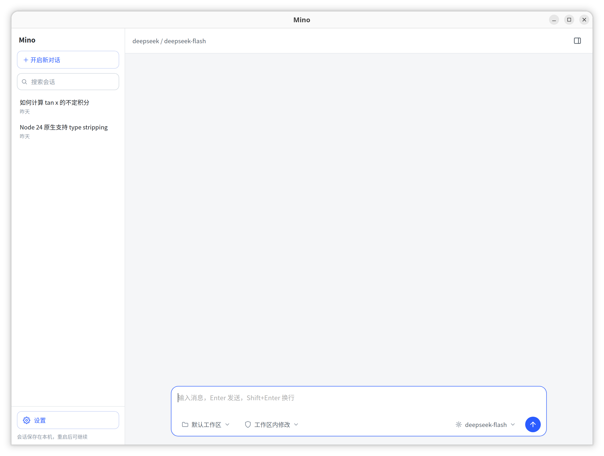
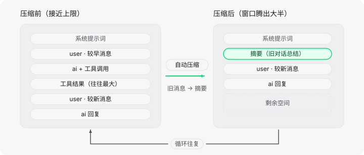

<p align="center">
  
</p>

# Mino



基于 LangChain.js 的桌面 AI Agent：原生 webview 窗口，轻量无 Electron，启动即用。Node.js ≥ 24 直接运行 ，零构建步骤。

## 启动依赖

### 通用

| 依赖      | 要求                         |
| ------- | -------------------------- |
| Node.js | ≥ 24（直接运行 TypeScript，无需编译） |

### 各平台

| 平台      | 必需                                   | 可选 / 说明                                                            |
| ------- | ------------------------------------ | ------------------------------------------------------------------ |
| Linux   | WebKitGTK 4.1、`libxdo`、X11 或 Wayland | `zenity`：目录选择器；`script`（util-linux）：内嵌终端伪 PTY；`stty`：终端尺寸同步；`bash` |
| Windows | WebView2 Runtime、PowerShell          | Win11 与新版 Edge 自带 WebView2，Win10 缺失时会弹窗引导安装                        |
| macOS   | 11 及以上（系统自带 WebKit）                  | `script`、`pgrep` / `ps`：终端尺寸同步                                     |

Debian / Ubuntu 安装示例（包名因发行版而异）：

```bash
sudo apt install libwebkit2gtk-4.1-0 libxdo3 zenity util-linux
```

## 运行

```bash
npm install
npm start                # 打开对话窗口（在「设置 → 模型」里添加模型配置）
npm run typecheck        # tsc --noEmit 类型检查
```

支持 OpenAI / Anthropic / DeepSeek 及任意 OpenAI 兼容接口（Moonshot、智谱、本地网关等）。

## 主流 Agent 的上下文压缩（auto-compact）

长对话的 token 持续增长，最终会超出模型的上下文窗口。主流 Agent 的通用解法是 auto-compact：**token 用量逼近阈值时，让模型把旧历史总结成一条摘要消息，再用「摘要 + 最近几轮」继续对话**，如此循环往复，对话即可无限继续。



### 主流 Agent 对比

| 工具                    | 上下文策略                                                                   |
| --------------------- | ----------------------------------------------------------------------- |
| Claude Code           | 接近上限自动压缩（约 92%），`/compact` 手动压缩；配合工具输出截断、子代理隔离                          |
| Cursor                | `/compact` 手动摘要；接近上限时自动浓缩旧对话                                            |
| Cline / Roo Code      | 滑动窗口截断 ＋ auto-compact 把历史浓缩成摘要后开新上下文                                    |
| LangChain / LangGraph | `trimMessages` 滑窗截断；`summarizationMiddleware` 摘要压缩（Mino 在用）             |
| **Mino（本项目）**         | `summarizationMiddleware`：token 估算 ≥ 16,000 触发，旧消息 → 一条摘要，保留最近 20 条，全自动 |

### Mino 的实现

配置在 [src/agent.ts](src/agent.ts)：

```ts
middleware: [
  summarizationMiddleware({
    model: buildModel(config),   // 做摘要的模型，可换成更便宜的
    trigger: { tokens: 16000 },  // token 估算 ≥ 16000 时触发
    keep: { messages: 20 },      // 保留最近 20 条消息
  }),
],
```

